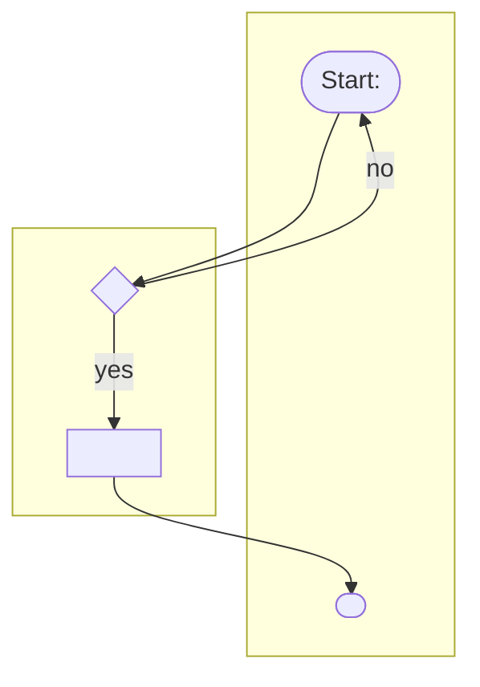
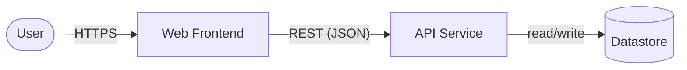
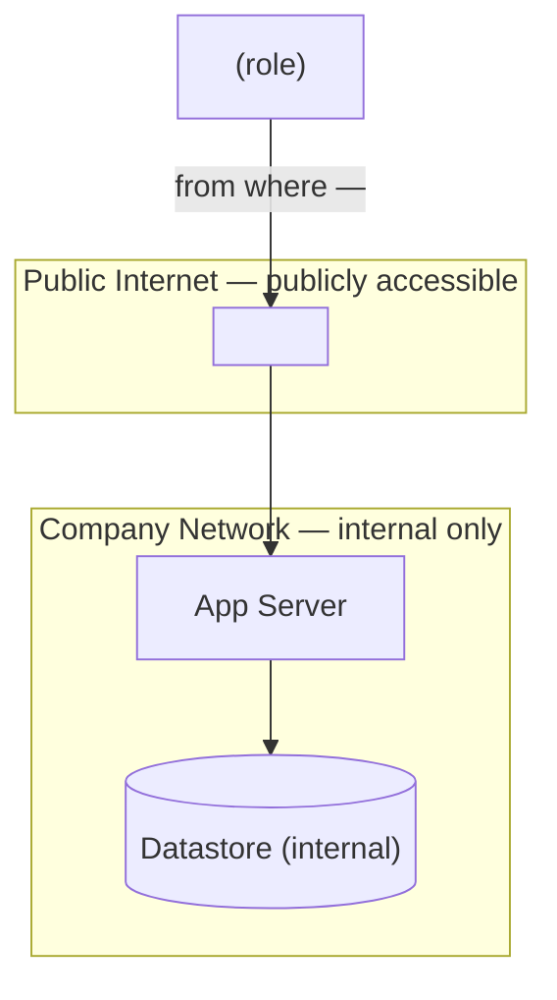
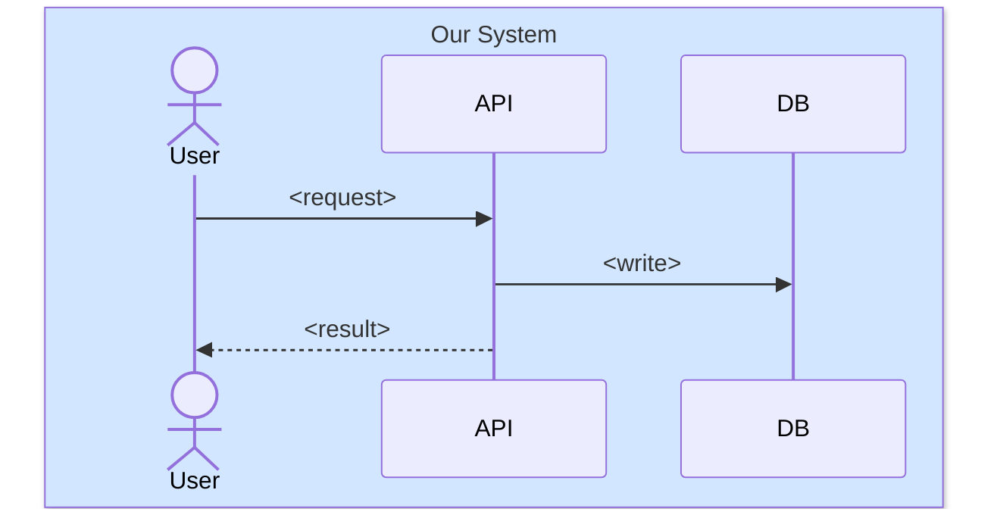
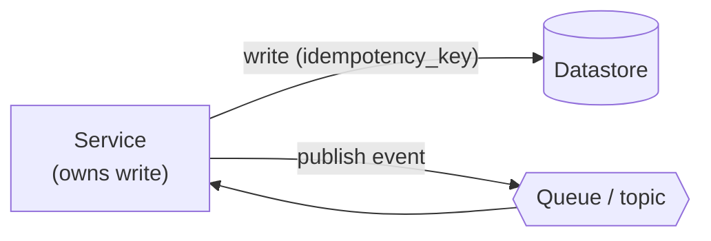
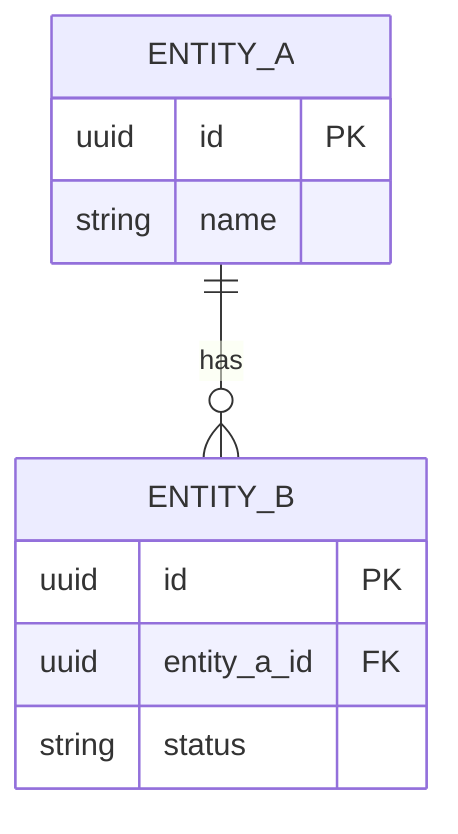

# Design Document Template Reference

The scaffold for `docs/DESIGN.md`. Copy the block below into `docs/DESIGN.md` and fill it in.

**How to use this scaffold**

- Every section has an HTML comment (`<!-- … -->`) stating **what it must contain**, **where the content
  comes from** (code-inferred vs owner input), and **what "done" looks like**. Keep the comments while
  drafting; they are guidance, not output. Remove them once the section is complete.
- Fill everything the code and existing docs prove. Mark everything else `⚠️` and close it in the interview
  (Phase 3). Never invent content to make a section look finished.
- Where a required element does not exist in this project, write `N/A — <reason> (confirm with owner)`
  rather than deleting the heading — the reviewer needs to see it was considered.
- **Diagrams are written inline as ` ```mermaid ` fenced blocks** — they live in this document and render
  natively on GitHub. No separate `.puml`/`.svg` files, no image links. See `mermaid-guide.md`.
- The distributable **`docs/DESIGN.pdf`** is generated last, after this document is finalized (Phase 5) — an
  exact copy of the finalized DESIGN.md. It is not committed.

The scaffold is wrapped in a four-backtick ` ````markdown ` fence so the inner ` ```mermaid ` blocks nest
correctly — copy everything between the fences.

---

````markdown
# Design Document — <Project Name>

> Design-review document for the Tech Architecture Group. Generated by the `design-document` skill from the
> codebase and the docs in this repo, then completed by the project owner. Companion to `PROJECT.md`
> (go-live dossier) and `docs/ARCHITECTURE.md` (as-built architecture).

<!-- Diagrams are inline Mermaid and render on GitHub. The distributable docs/DESIGN.pdf is produced by the
     design-document skill AFTER this document is finalized, as an exact copy with links resolved to the repo
     on GitHub. Diagrams are never sent to a hosted renderer. -->

## Product Overview & Objectives

<!-- What the product does, who it is for, the problem it solves, and the objectives it must meet. Inferred
     from README and PROJECT.md "Problem Being Solved"; objectives/success criteria are owner input where the
     code cannot prove them. If a PRD exists, link it. DONE = a reviewer who never saw the code understands
     what this is, why it exists, and what "success" means. -->

- **What it is:** <one-paragraph summary>
- **Objectives / goals:** <what it must achieve — success criteria / intended outcome> / ⚠️ owner input
- **PRD:** ⚠️ owner input — link the Product Requirements Document, or "no PRD".

---

## Business Workflow

<!-- The end-to-end BUSINESS process and the intention behind it — what the tool is for, in terms a
     non-engineer stakeholder recognizes. Prose on the intent, then a Mermaid flowchart with one swimlane
     (subgraph) per role/actor/team the process crosses. Source: routes/jobs/domain flow (inferred); the
     business intent and step ownership are ⚠️ owner input. DONE = the reviewer can trace the process from
     trigger to outcome and see which role does what. -->

**Intent:** <why this workflow exists / the business outcome it drives> / ⚠️



---

## Architecture Diagrams

<!-- Diagrams are authored inline in Mermaid (see mermaid-guide.md). List the views included below. -->

### A. Component / Deployment Diagram

<!-- COMPONENT diagram: the solution's high-level structure — major components/services and their
     responsibilities, the request/response flows between them, the major data exchanged, and key system
     dependencies (DBs, queues, third-party services from docs/DEPENDENCIES.md). One diagram per application.
     Source: docs/ARCHITECTURE.md component map + code.
     DEPLOYMENT diagram (REQUIRED — not optional): show the access / trust boundary —
       (1) WHO can access each component (user groups / roles);
       (2) FROM WHERE (the network zone each actor sits in);
       (3) which nodes are COMPANY-NETWORK-ONLY vs (4) which are PUBLICLY ACCESSIBLE — as explicit zones;
       (5) the LOGIN METHOD on each entry point (Apps Gateway SSO / Company Google OAuth).
     Source: PROJECT.md Access Status / Login Method / Access Levels + code (roles, ingress, public routes).
     Mark network-zone and public-vs-internal boundaries ⚠️ confirm if the code doesn't settle them.
     DONE = a reviewer can see what talks to what, and who can reach what from where, under which login. -->

**Component view**



**Deployment & access boundary**



### B. Sequence Diagrams & System Boundaries

<!-- One sequence diagram PER MAJOR use case / flow / feature / module. For each:
       - group participants with `box` to show the SYSTEM BOUNDARY (our system vs external);
       - HIGHLIGHT any financial-asset / payment / loyalty-point flow (wrap steps in a colored `rect`;
         state the color convention once);
       - show ROLE-BASED ACCESS DIFFERENCES where they exist (`alt role = …`, or steps only one role can
         trigger).
     Provide high-level always; add a low-level diagram where a flow is complex.
     Source: use cases from docs/API.md / routes + roles/permissions from code.
     ⚠️ confirm which use cases are "major", the exact boundaries, and the role differences.
     DONE = each major flow has a diagram whose actors, boundary crossings, and per-call data are clear. -->

Colored `rect` = financial-asset / payment / loyalty flow.

**Use case: <name>**



<!-- Repeat per major use case. -->

### C. Queue / Data Storage for Transactions

<!-- How transactional data and financial assets move through queues / event streams / data stores /
     databases. Cover: which UPSTREAM systems can access the data; TRANSACTION OWNERSHIP (which service
     owns the write); DATA MOVEMENT between systems; and FAILURE & RECOVERY considerations.
     Source: DB / queue / event client usage in code (inferred); ownership + failure/recovery ⚠️ confirm.
     If there is no transactional/financial data, reduce this to the plain data-flow and say so. -->



- **Transaction ownership:** ⚠️ confirm — which service owns each write.
- **Upstream systems with access:** <from code / ⚠️ confirm>
- **Failure & recovery:** ⚠️ confirm — what happens mid-transaction, and how state is restored.

---

## Database Schema

<!-- The persistent data model. An `erDiagram` for shape (entities, PK/FK, relationships) PLUS one field
     table per table for detail. Types come from the ORM schema / migrations / DDL (Drizzle drizzle.config.ts + drizzle-orm schema files, schema.prisma, TypeORM /
     Sequelize entities, SQL); per-field DESCRIPTIONS are owner-confirmed where the code doesn't make them
     obvious. If the project has NO datastore, write "N/A — no datastore detected in code (confirm with
     owner)" and omit the diagram. DONE = a reviewer knows every table, column, type, key, and what each
     field means. -->



**Table: `<table_name>`**

| Field | Type | Nullable | Key | Description |
|-------|------|----------|-----|-------------|
| id | uuid | no | PK | <what it identifies> |
| <field> | <type> | yes/no | FK/UNIQUE/— | <meaning> / ⚠️ |

<!-- Repeat one table per persistent entity. -->

---

## External Connections & Integrations

<!-- Every inbound and outbound connection to systems OUTSIDE this application: third-party APIs, partner
     systems, message brokers, webhooks/callbacks, internal shared services. For each, capture WHAT data,
     WHY (purpose), WHERE (host/endpoint/network zone), WHEN (trigger/frequency), HOW (protocol + auth), and
     the DIRECTION of data flow (inbound / outbound / both). Source: outbound HTTP clients/SDKs, inbound
     webhook handlers, broker clients + docs/DEPENDENCIES.md (inferred); WHY/WHEN and auth details are
     ⚠️ owner input where code doesn't settle them. No external connections → "N/A — none detected in code
     (confirm with owner)". DONE = a reviewer sees every boundary crossing and how data enters and leaves. -->

| Integration | Direction | What (data) | Why (purpose) | Where (host/endpoint/zone) | When (trigger/frequency) | How (protocol + auth) |
|-------------|-----------|-------------|---------------|----------------------------|--------------------------|-----------------------|
| <system> | outbound | <fields sent> | <reason> | <host / zone> | <event / schedule> | <HTTPS/REST; API key/OAuth> |
| <system> | inbound | <fields received> | <reason> | <endpoint we expose> | <webhook / poll> | <protocol; how authenticated> |

<!-- Optional: a Mermaid flowchart of inflow/outflow if it clarifies the boundary. -->

Cross-reference `docs/DEPENDENCIES.md` for the full vendor inventory — do not duplicate it here.

---

## Financial Risks & Mitigation

<!-- If Phase 1 found NO financial/transactional surface, replace the four subsections with:
     "N/A — no financial assets or transactions detected in code (confirm with owner)" and stop here.
     Otherwise complete each subsection. Every mitigation claim is VERIFIED against code and tagged
     CONFIRMED / CONTRADICTED / UNVERIFIABLE with a file:line. Never write an unverified claim as fact. -->

### Race Conditions

<!-- Potential race conditions during asset/balance updates, concurrent-processing risks, and the
     consistency guarantees relied on. Code hints: locks, transactions, isolation level, SELECT … FOR
     UPDATE, compare-and-swap, optimistic version columns. Owner supplies the reasoning; you verify it. -->

- **Risk:** <where concurrent updates could corrupt an asset/balance>
- **Guarantee & evidence:** <mechanism> — CONFIRMED/CONTRADICTED/UNVERIFIABLE (`file:line`)

### Failure Models

<!-- Failure scenarios during financial transactions and the mitigation: IDEMPOTENCY strategy, RETRY
     strategy, and COMPENSATION / ROLLBACK mechanism. Code hints: idempotency keys, retry libraries/backoff,
     saga/outbox patterns, DB transactions/rollbacks. Verify each against code. -->

- **Idempotency:** <strategy> — evidence (`file:line`) / ⚠️
- **Retry:** <strategy> — evidence / ⚠️
- **Compensation / rollback:** <strategy> — evidence / ⚠️

### Duplicate Transaction Detection

<!-- How duplicate transactions are identified, the cross-service DEDUPLICATION strategy, and the
     TRANSACTION IDENTIFIERS / tracking mechanism (idempotency key, request id, unique constraint). -->

- **Detection mechanism:** <mechanism> — evidence (`file:line`) / ⚠️
- **Transaction identifier:** <id scheme> — evidence / ⚠️

### API Security

<!-- SUMMARY ONLY — cross-reference docs/SECURITY.md; do NOT restate it. Note authentication approach,
     authorization model, encryption, sensitive-data handling, and compliance, each as a one-liner that
     points at the SECURITY.md section. Login method must be Apps Gateway SSO or Company Google OAuth
     (per PROJECT.md); flag anything else as a compliance gap.
     Reference: Tech Arch Group guidelines (Confluence TAG space). -->

See [`docs/SECURITY.md`](SECURITY.md) for the full security posture. Design-review summary:

- **Authentication / login:** <Apps Gateway SSO | Company Google OAuth> — see SECURITY.md
- **Authorization model:** <roles/permissions> — see SECURITY.md
- **Encryption & sensitive data:** <in transit/at rest; what's sensitive> — see SECURITY.md
- **Compliance:** <relevant considerations> / ⚠️

---

## Review Checklist

<!-- Tick an item ONLY when its supporting content exists in this document. Leave the rest unticked — they
     are the outstanding work. This mirrors status; it is not a formality. -->

### Architecture
- [ ] Product overview provided
- [ ] Objectives / goals stated
- [ ] Business workflow diagram included
- [ ] Component diagram included
- [ ] Deployment diagram included (access/trust boundary: who, from where, network-only vs public, login)
- [ ] Sequence diagrams included for major use cases
- [ ] System boundaries clearly defined
- [ ] Role-based access differences shown where they exist
- [ ] All Mermaid diagrams parse locally (mmdc / headless / static-lint — method noted in the run output)

### Data & Integrations
- [ ] Database schema documented (fields, types, descriptions)
- [ ] Transaction flow documented
- [ ] Queue / data-store architecture documented
- [ ] Transaction ownership defined
- [ ] External connections documented (direction, purpose, protocol, auth)
- [ ] Upstream / downstream dependencies listed

### Financial Risk Assessment
- [ ] Race conditions identified (or N/A — no financial surface)
- [ ] Failure models documented (idempotency / retry / compensation)
- [ ] Duplicate-transaction prevention documented
- [ ] Recovery strategy documented

### Security
- [ ] API security reviewed (cross-referenced to SECURITY.md)
- [ ] Authentication documented
- [ ] Authorization documented
- [ ] Sensitive-data handling documented
````
