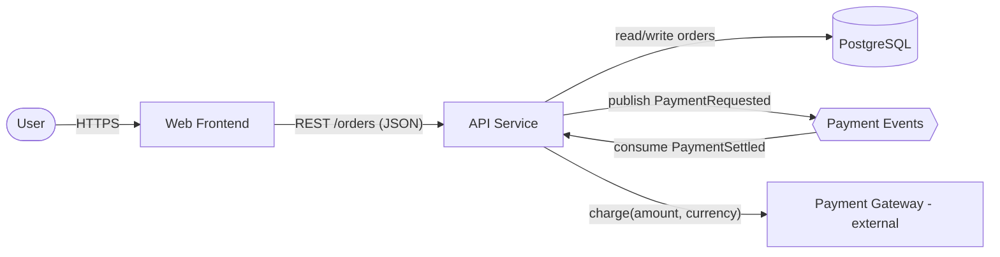
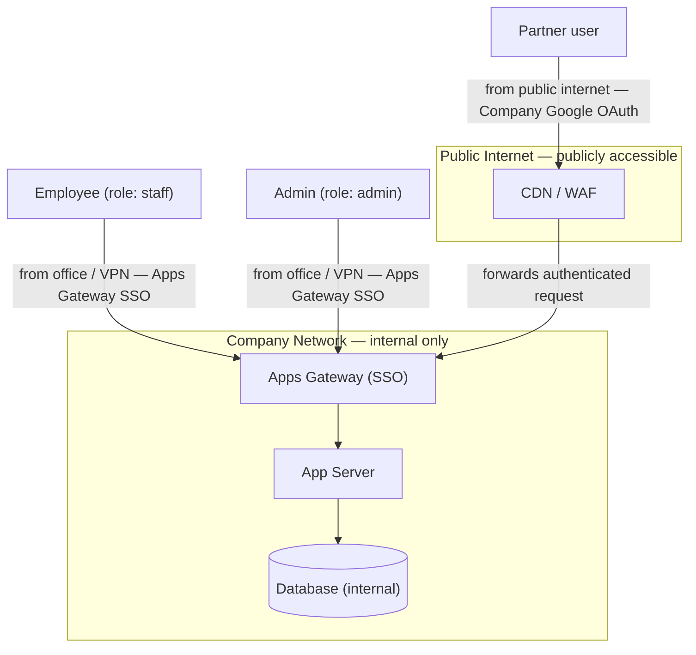
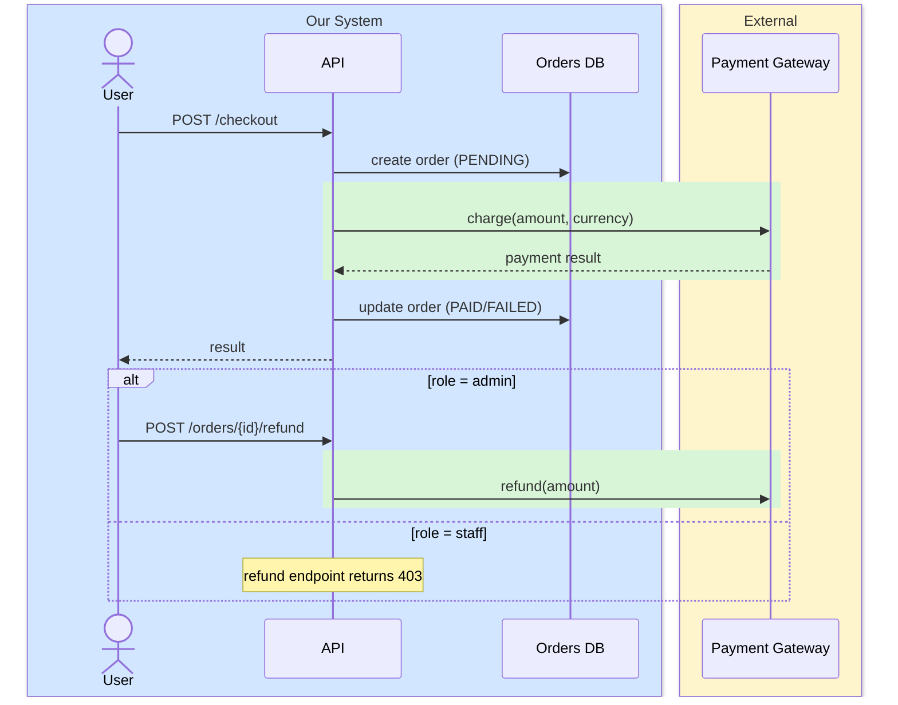
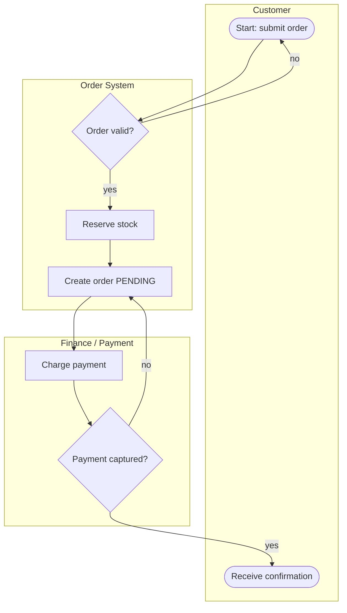
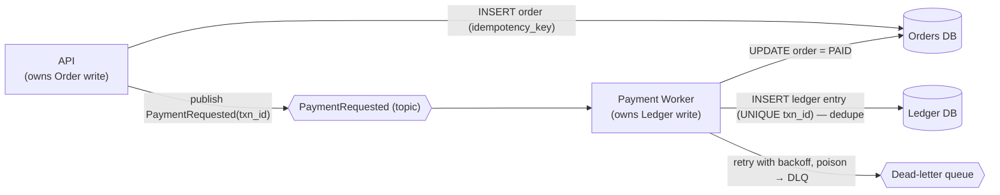
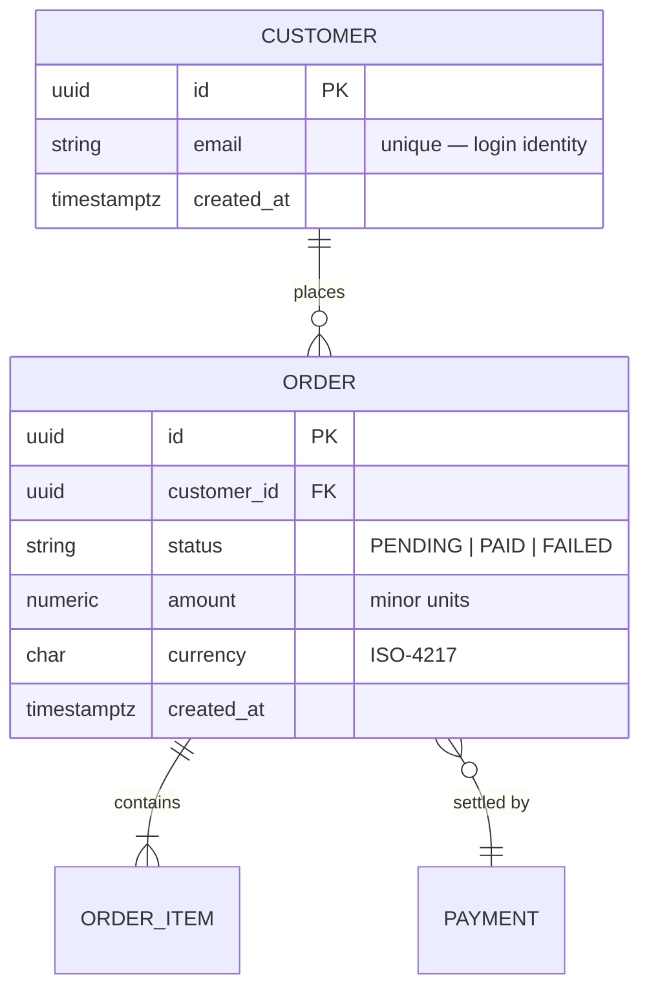

# Mermaid Authoring & Local PDF Rendering

How to author each diagram the design document needs, **written inline in `docs/DESIGN.md`** as fenced
` ```mermaid ` blocks. GitHub renders Mermaid natively, so the diagram lives in the document itself — no
separate `.puml`/`.svg` files, no image links.

## Resources

- Mermaid: https://mermaid.js.org
- Flowcharts: https://mermaid.js.org/syntax/flowchart.html
- Sequence diagrams: https://mermaid.js.org/syntax/sequenceDiagram.html
- Entity-relationship diagrams: https://mermaid.js.org/syntax/entityRelationshipDiagram.html
- Company example diagrams: Bitbucket `acme-org` workspace, `ARCHDIAGRAM` project.

---

## Rendering & the PDF copy — local only, never hosted

**Hard rule: diagram source must never be sent to a third-party rendering service.** No `mermaid.ink`, no
Kroki, no hosted Markdown-to-PDF converter. Mermaid committed to the repo and rendered by GitHub sits
within the same trust boundary as hosting the repo there; that is acceptable. Anything beyond that — an
ad-hoc external renderer — is not.

- **DESIGN.md needs no render step.** The ` ```mermaid ` blocks render inline on GitHub as-is.
- **The PDF (produced last, after DESIGN.md is finalized)** is rendered **locally**, first available method:
  1. A local Markdown→PDF tool on PATH that renders Mermaid — `md-to-pdf`, or `pandoc` (+ `wkhtmltopdf` /
     `weasyprint`) — used entirely offline.
  2. Otherwise a local **headless Edge/Chrome** (`msedge`/`chrome --headless --print-to-pdf`) printing a
     self-contained HTML built from DESIGN.md, with Mermaid rendered by a **locally bundled** `mermaid.min.js`
     (never a CDN fetch of the diagram source).
  3. No local toolchain → **skip the PDF**, keep the finalized `docs/DESIGN.md` as the deliverable, and print
     a one-line local-setup hint. Never fabricate a PDF and never route the content through a hosted service.

Detection is cheap — check for `md-to-pdf`, `pandoc`, then `msedge`/`chrome` before choosing a method, and
state in the run output which method produced the PDF.

---

## Special characters — reserved in Mermaid text (all diagram types)

Mermaid reserves a few characters in **unquoted** text. A stray one does not warn — it silently truncates the
statement and the whole diagram fails to parse the moment a reviewer opens the doc on GitHub. This bites
hardest in **sequence diagrams**.

- **`;` is a statement separator** (same role as a newline). Never put it in unquoted text — sequence
  messages, `Note` / `alt` / `opt` / `loop` labels. It truncates the statement and the parser then errors
  (`Parse error … Expecting 'SOLID_ARROW', … got 'NEWLINE'`). Use a **comma** or an **em dash `—`**, or wrap
  the whole label in `"…"`.
- **`#` begins an entity code** (`#59;` renders `;`, `#35;` renders `#`). To show a literal `#` in text,
  write `#35;`.
- **Sequence messages** — text after the `:` runs to end-of-line, so `()`, `,`, `=`, `<`, `>`, `{`, `}` are
  safe there **except `;`** (and `#…;`). When unsure, quote the label: `A->>B: "do x; do y"`.
- **Flowchart / ER labels** — quote any label containing `()`, `,`, `:`, or `;`. (An unquoted `;` may not
  fail the parse here, but it mangles the label — quote it.)

Every diagram is parsed before the document is finalized — see **Validating the Mermaid** at the end of this
guide.

---

## A. Component diagram

Structure, request/response flows, major data exchanged, key dependencies. One per application.

````markdown

````

Quote any edge/node label that contains `()`, `,`, `:`, or `;` (see **Special characters** above).

## A. Deployment diagram (access / trust boundary — required)

Show **who** accesses each node, **from where**, which nodes are **internal-only** vs **public**, and the
**login method** on each entry edge. Use `subgraph` blocks as network zones.

````markdown

````

- Label the login method (`Apps Gateway SSO` / `Company Google OAuth`) on every actor→entry edge.
- Put internal-only nodes in the company-network `subgraph`; public nodes in the public `subgraph`.
- Annotate each actor with its role and its network origin ("from where").

## B. Sequence diagram (boundaries + financial highlight + roles)

One per major use case / flow / feature / module. Group participants with `box` to draw the system
boundary, wrap money/loyalty steps in a colored `rect` to highlight them, and show role differences with
`alt`.

````markdown

````

- The colored `rect` = financial-asset / payment / loyalty-point flow. State the convention once in DESIGN.md.
- `box … end` = system boundary; keep external systems in their own box.
- `alt … else …` (or distinct role actors) = role-based access differences.
- **No unquoted `;` in message or `Note` / `alt` text** — it is a statement separator and silently breaks the
  diagram. Use a comma or em dash, or quote the whole label. See **Special characters** above.

## Business workflow diagram (business process + intent)

The end-to-end **business** process — what the tool is *for* — with role **swimlanes** as `subgraph`s.
Use this to convey intentions and the workflow, not the technical wiring.

````markdown

````

- One swimlane (`subgraph`) per role / actor / team the process crosses.
- Decision diamonds (`{...}`) for branch points; label the branch edges.
- Keep it business-level: steps a non-engineer stakeholder would recognize.

## C. Transaction / queue data-flow

How transactional data moves, who owns each write, deduplication, and failure/recovery.

````markdown

````

- Annotate ownership in the node label ("owns X write").
- Show the dedupe key (unique constraint / idempotency key) on the write that must not double-apply.
- Show the failure path (retry, DLQ, compensation) — recovery is a required part of this diagram.

## Database schema (entity-relationship)

Accompanies the field tables in the **Database Schema** section. Show entities, keys, and relationships;
put per-field type + description in the markdown table beside it (the ER diagram carries the shape, the
table carries the detail).

````markdown

````

- Mark `PK` / `FK` on key columns; use relationship cardinality (`||--o{`, `}o--||`, `||--|{`).
- The diagram is inferred from ORM models / migrations / DDL; per-field **descriptions** are owner-confirmed.
- No datastore in the project → omit the diagram and mark the Database Schema section `N/A`.

---

## Validating the Mermaid — local only, before finalizing

Every ` ```mermaid ` block in `DESIGN.md` must **parse** before the document is finalized (and therefore
before the PDF). Validation runs **locally** — the same trust rule as rendering: never send diagram source to
a hosted service. Use the first method available and state which one you used in the run output:

1. **`mmdc`** (`@mermaid-js/mermaid-cli`) if on PATH — it parses each block as it renders:

   ```bash
   mmdc -i docs/DESIGN.md -o docs/_validate.md   # non-zero exit + stderr on a bad block; discard _validate* after
   ```

2. Otherwise a **local headless parse** — `mermaid` + `jsdom` in a scratch dir, calling `mermaid.parse()` on
   each fenced block and exiting non-zero on any failure:

   ```js
   // scratch: npm i mermaid jsdom ; node verify.mjs docs/DESIGN.md
   import { readFileSync } from 'fs';
   import { JSDOM } from 'jsdom';
   const dom = new JSDOM('<!DOCTYPE html><body></body>', { pretendToBeVisual: true });
   Object.defineProperty(globalThis, 'window', { value: dom.window, configurable: true, writable: true });
   for (const k of Object.getOwnPropertyNames(dom.window)) {
     if (k in globalThis) continue;
     try { Object.defineProperty(globalThis, k, { value: dom.window[k], configurable: true, writable: true }); } catch {}
   }
   const mermaid = (await import('mermaid')).default;
   mermaid.initialize({ startOnLoad: false, securityLevel: 'loose' });
   const text = readFileSync(process.argv[2], 'utf8');
   let m, i = 0, fails = 0; const re = /```mermaid\r?\n([\s\S]*?)```/g;
   while ((m = re.exec(text))) { i++; try { await mermaid.parse(m[1]); }
     catch (e) { fails++; console.log(`Block #${i} FAIL: ${String(e.message||e).split('\n')[0]}`); } }
   console.log(fails ? `${fails}/${i} FAILED` : `All ${i} OK`); process.exit(fails ? 1 : 0);
   ```

3. **No toolchain → static lint** (and say so). Scan each ` ```mermaid ` block and reject:
   - a `sequenceDiagram` block whose message / `Note` / `alt` / `opt` / `loop` text contains an **unquoted
     `;`** (a `;` outside `"…"`), or a `#` that is not part of a `#\d+;` entity code;
   - a flowchart / `erDiagram` label with an unquoted special character.

   A static lint is weaker than a real parse — note in the run output that no parser was available.

A block that does not parse is a **blocking finalization failure**, not a warning: fix the diagram and
re-validate. The PDF (Phase 5) is never generated from a document with an unparseable diagram.
